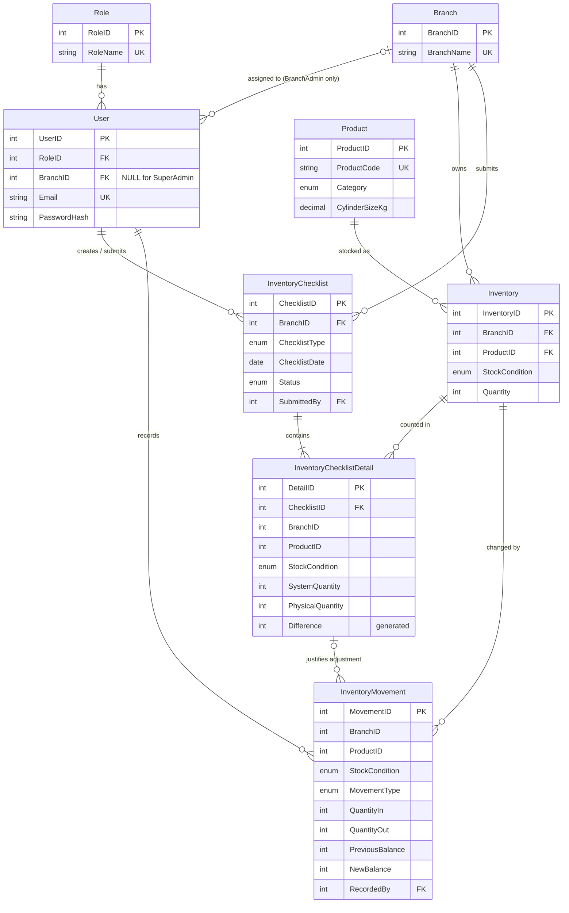

# K4J LPG Inventory & Checklist System – ERD and Data Dictionary

Database: `k4j_lpg` (MySQL / MariaDB, InnoDB, utf8mb4)
Script: `01_k4j_lpg_schema.sql`

## 1. Entity Relationship Diagram

## 2. Design decisions (for defense)

1. **Stock is separated by Branch + Product + StockCondition.** `Inventory` has a unique key on those three columns, so JPang and Daet can never share a balance row. Conditions: `FILLED`, `EMPTY`, `REVOLVING` (cylinders in the field), `DAMAGED`; accessories use `GENERAL`.
2. **Required fields were extended with `StockCondition`.** Your spec lists `ProductID` only for movements and checklist details, but because each condition has its own balance, those tables also need to say *which* balance they refer to. Composite foreign keys `(BranchID, ProductID, StockCondition) → Inventory` make it impossible to record a movement or count for a branch/item that does not exist.
3. **Branch consistency is enforced by the database.** `InventoryChecklistDetail` repeats `BranchID` and has a composite FK to its checklist, so a detail line cannot belong to a different branch than its checklist.
4. **Super Admin vs Branch Admin:** `User.BranchID` is NULL for Super Admin and required for Branch Admin (CHECK constraint). The service layer reads the branch from the logged-in user, never from a UI dropdown, for Branch Admins.
5. **Discrepancies never overwrite stock.** Checklist submission only stores `SystemQuantity`, `PhysicalQuantity`, and the computed `Difference`. Correcting stock requires an `ADJUSTMENT` movement with a mandatory reason and `RecordedBy`; it can point to the checklist line that revealed it (`ChecklistDetailID`).
6. **Movements are an append-only ledger.** Triggers block UPDATE/DELETE. The CHECK constraint `NewBalance = PreviousBalance + QuantityIn - QuantityOut` is enforced by the database.
7. **Submitted checklists are locked** by triggers (header and detail lines).
8. **One Opening and one Closing checklist per branch per day** (unique key).
9. **Status values:** `DRAFT` (saved, editable) and `SUBMITTED` (final).
10. **Opening checklist semantics:** `SystemQuantity` = current inventory balance; `PreviousClosingQuantity` = physical count from the last submitted Closing checklist, shown for reference. **Closing:** `SystemQuantity` = expected balance after the day's movements.

### Rules left to the service layer (cannot be expressed in plain constraints)
- Roles/branch authorization on every call.
- `PreviousBalance` must equal the current `Inventory.Quantity` (read with `SELECT ... FOR UPDATE` inside the same transaction that updates `Inventory` and inserts the movement).
- Remarks are required for every line where `Difference <> 0` before a checklist can be submitted.
- Cylinders get four condition rows per branch; accessories get `GENERAL` only.
- Only a Branch Admin (for their own branch) may record adjustments; Super Admin is read-only.

## 3. Data dictionary

### Role
| Column | Type | Null | Key | Notes |
|---|---|---|---|---|
| RoleID | INT UNSIGNED | No | PK | 1 = SuperAdmin, 2 = BranchAdmin |
| RoleName | VARCHAR(30) | No | UK | |
| Description | VARCHAR(150) | Yes | | |

### Branch
| Column | Type | Null | Key | Notes |
|---|---|---|---|---|
| BranchID | INT UNSIGNED | No | PK | 1 = JPang, 2 = Daet |
| BranchName | VARCHAR(50) | No | UK | |
| Address | VARCHAR(200) | Yes | | |
| IsActive | TINYINT(1) | No | | default 1 |

### User
| Column | Type | Null | Key | Notes |
|---|---|---|---|---|
| UserID | INT UNSIGNED | No | PK | |
| RoleID | INT UNSIGNED | No | FK → Role | |
| BranchID | INT UNSIGNED | Yes | FK → Branch | NULL only for SuperAdmin |
| FullName | VARCHAR(100) | No | | |
| Email | VARCHAR(100) | No | UK | Login identifier (matches existing login form) |
| PasswordHash | VARCHAR(255) | No | | PBKDF2-SHA256 string from `PasswordSecurity.vb` |
| IsActive | TINYINT(1) | No | | |
| CreatedAt / LastLoginAt | DATETIME | No / Yes | | |

### Product
| Column | Type | Null | Key | Notes |
|---|---|---|---|---|
| ProductID | INT UNSIGNED | No | PK | |
| ProductCode | VARCHAR(30) | No | UK | |
| ProductName | VARCHAR(100) | No | | |
| Brand | VARCHAR(50) | Yes | | |
| Category | ENUM | No | | LPG_CYLINDER, ACCESSORY |
| CylinderSizeKg | DECIMAL(5,2) | Yes | | Required for cylinders, NULL for accessories |
| IsActive | TINYINT(1) | No | | |

### Inventory
| Column | Type | Null | Key | Notes |
|---|---|---|---|---|
| InventoryID | INT UNSIGNED | No | PK | |
| BranchID | INT UNSIGNED | No | FK, UK(1) | |
| ProductID | INT UNSIGNED | No | FK, UK(2) | |
| StockCondition | ENUM | No | UK(3) | FILLED, EMPTY, REVOLVING, DAMAGED, GENERAL |
| Quantity | INT | No | | CHECK ≥ 0 |
| LastUpdatedAt | DATETIME | No | | auto-updated |

### InventoryMovement
| Column | Type | Null | Key | Notes |
|---|---|---|---|---|
| MovementID | INT UNSIGNED | No | PK | |
| BranchID, ProductID, StockCondition | | No | composite FK → Inventory | |
| MovementType | ENUM | No | | INCOMING, OUTGOING, ADJUSTMENT |
| QuantityIn / QuantityOut | INT | No | | Exactly one is > 0 for INCOMING/OUTGOING |
| PreviousBalance / NewBalance | INT | No | | `New = Previous + In − Out`, both ≥ 0 |
| MovementDate | DATETIME | No | | |
| Description | VARCHAR(255) | No | | Reason; cannot be blank |
| RecordedBy | INT UNSIGNED | No | FK → User | |
| ChecklistDetailID | INT UNSIGNED | Yes | FK → InventoryChecklistDetail | Set when an adjustment resolves a checklist discrepancy |

### InventoryChecklist
| Column | Type | Null | Key | Notes |
|---|---|---|---|---|
| ChecklistID | INT UNSIGNED | No | PK | |
| BranchID | INT UNSIGNED | No | FK, UK | UK (Branch, Type, Date) |
| ChecklistType | ENUM | No | | OPENING, CLOSING |
| ChecklistDate | DATE | No | | |
| Status | ENUM | No | | DRAFT, SUBMITTED |
| CreatedBy / CreatedAt | | No | FK → User | |
| SubmittedBy / SubmissionDate | | Yes | FK → User | Both required when SUBMITTED, both NULL when DRAFT |

### InventoryChecklistDetail
| Column | Type | Null | Key | Notes |
|---|---|---|---|---|
| DetailID | INT UNSIGNED | No | PK | |
| ChecklistID, BranchID | | No | composite FK → InventoryChecklist | ON DELETE CASCADE (drafts only) |
| ProductID, StockCondition | | No | with BranchID: composite FK → Inventory | UK (Checklist, Product, Condition) |
| PreviousClosingQuantity | INT | Yes | | Opening checklists only |
| SystemQuantity | INT | No | | |
| PhysicalQuantity | INT | Yes | | NULL until counted |
| Difference | INT | Generated | | `PhysicalQuantity − SystemQuantity`; negative = missing, positive = excess |
| Remarks | VARCHAR(255) | Yes | | Required by service layer when Difference ≠ 0 |

## 4. Notes on your uploaded project

- The zip is a UI shell (login, sidebars, dashboards, many placeholder forms) with **no database code yet**. It already references `MySql.Data` and targets `net10.0-windows`.
- The login form has a **Role** and **Branch** dropdown. In the database design the branch comes from the user's account, so Step 3 will drop the branch dropdown for Branch Admins (a Branch Admin can never pick another branch).
- The project includes a **Rider** role plus customer, delivery, debt, EOD-sales and order forms. These are outside your stated scope, so the plan is to leave them untouched and hidden/disabled rather than build them.
- `PasswordSecurity.vb` (PBKDF2) will be reused for password storage.
